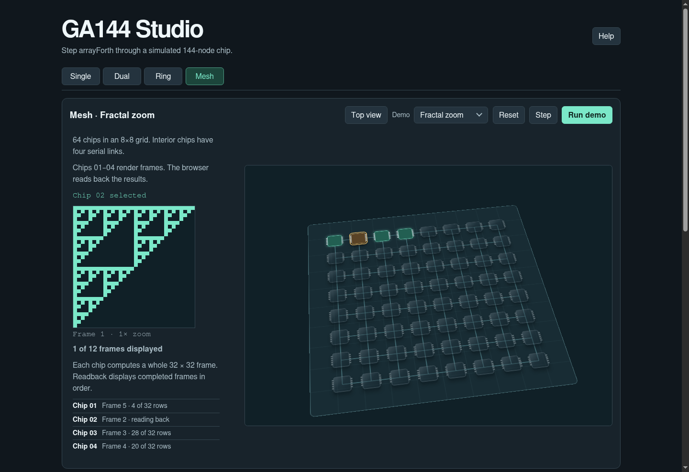

# sw-ga144

I attended SVFIG Forth Day on November 21, 2026. After listening to
Charles Moore, the creator of Forth, speak about GreenArrays GA144
hardware, I vibe-coded this repo to emulate the chip and demo some of
the concepts.

Write Forth for the GreenArrays GA144 and step it through a simulated
chip. The assembler is written in X_eTaL, the emulator in Rust, and the
browser UI in Yew/WebAssembly. The browser demo includes single-node
calculations and programs that send results across the chip.

[Open the live GA144 Studio demo](https://sw-embed.github.io/sw-ga144/) |
[GreenArrays website](https://www.greenarraychips.com/home/)



This demo is conceptual and based on public documentation. It has not
been validated against actual GreenArrays hardware or software.

## Build

Install a Rust toolchain with Edition 2024 support and build an
X_eTaL CLI. The assembler looks for `xetal` in `../X_eTaL`,
`../../softwarewrighter/X_eTaL`, and on `PATH`. Set `XETAL_BIN`
to select another build. See the
[X_eTaL repository](https://github.com/softwarewrighter/X_eTaL)
for source and build instructions.

From this repository, build the emulator and CLI.

```sh
cargo build --locked
```

To build the browser demo, install Trunk and the WebAssembly target.

```sh
rustup target add wasm32-unknown-unknown
cargo install --locked trunk
(cd web && trunk build --locked)
```

Trunk assembles the bundled programs at build time and writes the
static site to `web/dist/`. Serve that directory with any static HTTP
server, or start the Trunk development server using the instructions
below.

### GitHub Pages

In the repository's **Settings > Pages**, set **Source** under **Build
and deployment** to **GitHub Actions**. Then open the **Publish GA144
Studio** workflow in **Actions** and click **Run workflow** on `main`.
Later pushes to `main` publish automatically. The
[Pages workflow](.github/workflows/pages.yml) builds the demo for the
repository's Pages path and publishes `web/dist/`.

## Run a program

```sh
./assemble examples/double.f18 | cargo run --quiet -- 8 000:1:-
```

This starts node 000 at RAM address 1, advances eight scheduler ticks,
and reports `T=42`. The program then loops in place, holding that result
as the chip continues to tick. Each listing line contains a decimal RAM address
and an unsigned decimal 18-bit word. The simulator initializes omitted
locations to `x15555`.

The following programs transfer 42 from node 000 to node 001. The
last argument for each node is its listing path.

```sh
./assemble examples/send.f18 > /tmp/send.img
./assemble examples/receive.f18 > /tmp/receive.img
cargo run --quiet -- 20 000:0:/tmp/send.img 001:0:/tmp/receive.img
```

## F18 source

| Source form | Effect |
| --- | --- |
| `( comment )` | Ignore a parenthesized comment. Comments may nest. |
| `: name` | Align to a word boundary and name the current address. |
| `name` or `name ;` | Call a previously defined label, or tail-jump to it. |
| `42`, `-1`, `x2a`, `0x2a` | Assemble `@p` and an 18-bit literal. The optional minus sign encodes a two's-complement cell. Use at most six digits. |
| `# n org` | Align and advance the origin to RAM address `n` (0 through 63). |
| `# n ,` | Append a raw cell. For example, `@p # 42 ,` explicitly assembles a literal. |
| `# n call` or `# n jump` | Transfer to an explicit address from 0 through 1023. The `#` forms also accept previously defined labels as operands. |
| `..` | Align by filling unused slots with nops. |
| `if`, `-if`, `ahead`, `leap` | Emit a forward conditional jump, jump, or call. Close with `then`, with an optional `else` for an alternate path. |
| `begin ... again`, `begin ... until`, `begin ... -until` | Loop back to the aligned entry unconditionally or on the F18A condition. |
| `begin ... while ... repeat` | Exit on zero. Use `-while` to exit on a nonnegative value. |
| `for ... next` or `for ... unext` | Run a counted loop with initial count plus one iterations. The `unext` loop body must fit in one instruction word. |

Native opcode words include `; ex @p @+ @b @ !p !+ !b ! +* 2* 2/ inv
+ and xor drop dup r> over a . >r b! a!`. Words are case-sensitive.
Unresolved control transfers reserve slot 0. Known destinations use
the current slot when reachable after preceding `@p` and `!p`
operations. Origins move forward through a single 64-word RAM image.
DB013's host interpreter, automatic ROM symbols, persistent bins,
and boot descriptor language are outside this assembler's vocabulary.

## Emulator and browser demo

The Rust library models the 8-by-18 grid, packed instruction execution,
circular stacks, 18-bit arithmetic, RAM and optional caller-supplied
ROM, port execution, and blocking port transfers between nodes. A
scheduler tick gives each runnable node one fetch or opcode, then
matches pending port operations. This is an instruction-level model.
Board reset and boot ROM images, GPIO and external peripherals,
and physical timing remain outside the current model.

### Local Yew/WASM demo

Build and serve the demo with Trunk and the Rust
`wasm32-unknown-unknown` target. The build invokes the X_eTaL assembler
for the bundled programs.

```sh
cd web
trunk serve
```

Open the local URL printed by Trunk. Choose a single-node or multi-node
example from **Demo**, then select **Step** or **Run demo**. The dropdown
loads the program and selects the node where the result appears in
`T`. Use **Help** for a guide to running and loading programs. Click any node to inspect its source, registers, and RAM. To run
your own Forth, assemble it with `./assemble` and paste the output into
**Load an assembler listing**.

For an offline file preview, run `trunk build` and `python3 standalone.py`
from `web/`. Open the resulting `web/dist/ga144-local.html` in a browser.
An offline Trunk build also needs the `wasm-bindgen` CLI version pinned
in `web/Cargo.lock`.

This demo uses Yew and the Rust emulator locally. Integration with the
X_eTaL-extensions shell and in-browser source assembly are future
steps. See the [development plan](docs/plan.md) for the chip-pair,
ring, and mesh milestones.

## Future TODOs

- Port the emulator to a development board such as the Arduino UNO Q.
- Run the GA144 emulator on a GPU.
- Implement a GA144 simulator on an FPGA, starting with one chip and scaling to a mesh.

## Verify

```sh
tests/gate.sh
cargo fmt --all -- --check
cargo clippy --locked --offline --all-targets --all-features -- -D warnings
cargo check --locked --offline --lib --target wasm32-unknown-unknown
```

## GreenArrays documentation

- Assembler directives and source organization, sections 4.2 and 4.3. [DB013 arrayForth 3 User's Manual](https://www.greenarraychips.com/home/documents/greg/DB013-221112-aFUSER.pdf)
- F18A instruction encoding, registers, and port behavior. [DB001 F18A Technology Reference](https://www.greenarraychips.com/home/documents/greg/DB001-221113-F18A.pdf)
- GA144 node layout and hardware details. [DB002 G144A12 Chip Reference](https://www.greenarraychips.com/home/documents/greg/DB002-110705-G144A12.pdf)
- Other manufacturer manuals, application notes, and updates. [GreenArrays download index](https://www.greenarraychips.com/home/documents/downindex.php)

Download the manuals directly from GreenArrays. Local copies in
`docs/*.pdf` are ignored by Git and are outside the build.

## License

[MIT License](LICENSE). [Copyright (c) 2026 Michael A Wright](COPYRIGHT).
